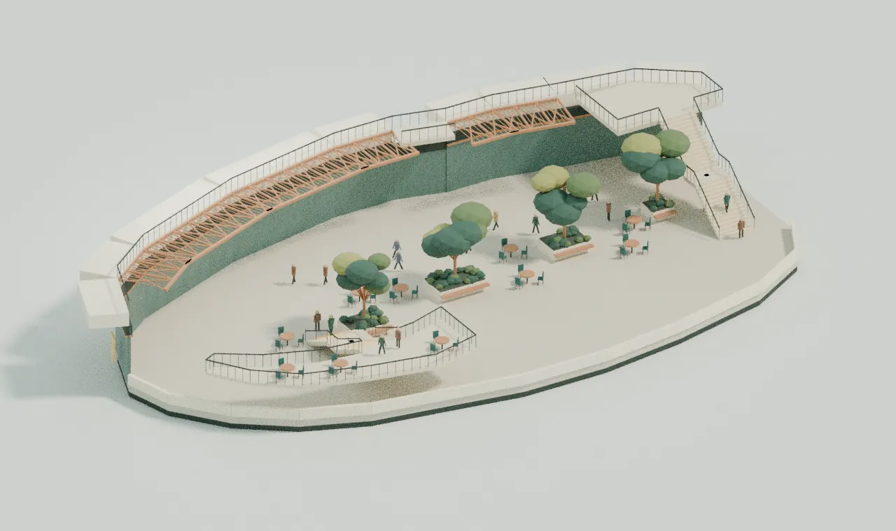
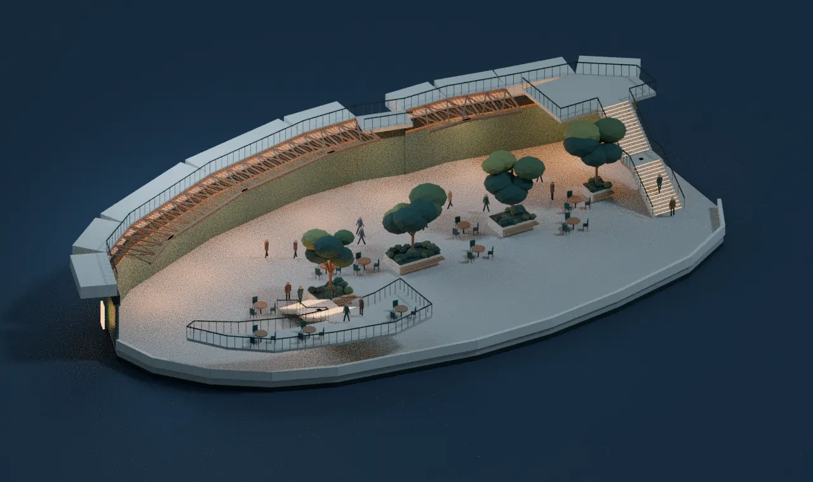
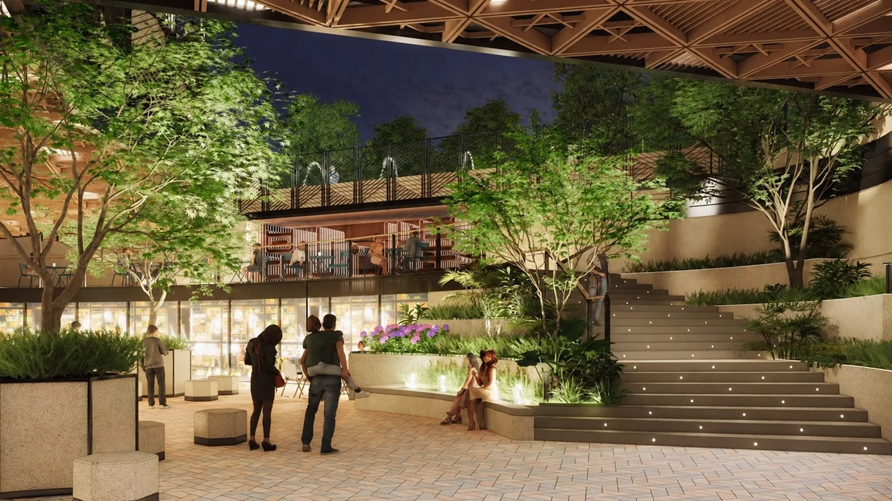

# 空间数字展示与三维漫游 · Spatial Digital Showcase

**Spatial Digital Showcase · 数字空间漫游**

[打开在线 Demo ↗](https://jaycefan666.github.io/spatial-digital-showcase/) · [下载工具包 ZIP ↓](https://github.com/JayceFan666/spatial-digital-showcase/archive/refs/heads/main.zip) · [使用方法](#在新项目中复用)

[](https://jaycefan666.github.io/spatial-digital-showcase/)

用浏览器带看商业空间、建筑、广场与展厅。即使空间还在筹开或改造，也可以先讲清入口、动线与使用场景，再让观众自由探索。

An open toolkit for interactive 3D walkthroughs of retail, architecture, courtyards and exhibitions. Open straight into the live model with WebGL 2. Orbit the scene, explore hotspots, change the atmosphere and capture the current 3D view. A five-view visual guide is available without WebGL.

## 五幕导览 / Five views

庭院全景 → 楼梯入口 → 弧形退台 → 商业外摆 → 夜景。下面两幅画面与网页预览，均由公开 Demo 的合成模型离线渲染，并非原项目照片。

| 03 · 弧形退台 / Terrace | 05 · 夜景 / After hours |
| :---: | :---: |
| [](https://jaycefan666.github.io/spatial-digital-showcase/) | [](https://jaycefan666.github.io/spatial-digital-showcase/) |

**在线：** 支持 WebGL 2 的浏览器会直接打开实时三维场景，可以旋转、缩放、切换日夜或季节，并点「截图」保存当前 3D 视角。「图文预览」可以独立查看或连续播放五幕画面；没有 WebGL 2 也能使用。

**本地：** 下载并解压工具包，在支持 WebGL 2 的浏览器中打开 `docs/index.html`，或在仓库根目录运行：

```sh
python3 -m http.server 8000 --directory docs
```

访问 `http://localhost:8000`。实时模型与五张预览均由仓库提供，无需账户、API 密钥或外部资源。

## 项目案例 / Project reference



案例效果图由用户提供，经许可展示。它不是上方公开模型的渲染，也不包含在代码 MIT 许可中。  
Reference rendering provided by the project owner and shown with permission. Not a capture of the public demo or covered by the code’s MIT license.

## 在新项目中复用

1. **核对资料**。说明展示目标、观众、入口、动线及必讲节点，确认公开范围。
2. **搭建空间**。按项目重做空间几何和尺度关系，先核对楼层、开口、连接关系，再补材质、植栽和家具。
3. **配置点位**。每个点位讲一件观众需要理解的事，配一个能看清实物关系的镜头。
4. **编排带看**。用全景建立方位，从主要动线进入，再安排停留、业态或夜间氛围等场景。根据项目调整分幕。
5. **检查交付**。在手机和桌面走完导览，核对镜头穿插、遮挡、交互和公开素材。

将 [skills/spatial-walkthrough](skills/spatial-walkthrough) 加入支持 SKILL.md 的开发代理，或让代理直接读取 [Skill 入口](skills/spatial-walkthrough/SKILL.md)。可从[项目任务书](skills/spatial-walkthrough/templates/brief.md)、[镜头与点位配置](skills/spatial-walkthrough/templates/scenes.json)和[视觉与交付检查表](skills/spatial-walkthrough/references/review.md)开始。Demo 的镜头和场景在 `docs/walkthrough.js`，样式在 `docs/style.css`。

## 需要准备的材料

**核心材料**：准备能说明空间的图纸（如 CAD、平面或剖面图）、关键点位图片、关键距离和高度，以及特殊场景或展示要求（如曲线退台、夜景、希望重点呈现的节点）。原始图纸仅用于本地制作，不随成品发布。

**制作说明**：再简要写下用途、目标观众、空间关系、必讲点位、视觉参考和交付方式。这些信息是为了让 AI 更准确地理解这次网页要解决什么问题，也帮制作者自己理清要展示什么、为什么展示、怎样展示。

**Inputs**: plans or sections, key-view images, principal measurements, and distinctive scenes or presentation requirements. Add a short brief covering the purpose, audience, spatial relationships, priority viewpoints, visual references, and delivery format.

对外使用的素材请标明出处、许可和可用范围。工具包提供可复用的展示流程、交互和模板，不会自动把 CAD 转成网页。新项目的几何、材质和机位需按实际空间重新制作。

## 隐私与发布

原始 CAD、项目源图纸、带尺寸的平面或剖面截图、内部资料及录屏始终留在本地，严禁提交到仓库。发布前还要检查注释、路径、链接、媒体元数据、资源包和模型属性。包含精确原图坐标、标高、尺寸表或专有图纸数据的模型应留在私有工作区。来源或公开权限存疑的资产先搁置。

```sh
python3 scripts/prepublish.py --tree
# git add 经过审核的发布文件后，再检查即将提交的内容
python3 scripts/prepublish.py
```

脚本筛查常见的私有文件、路径、内嵌资源和密钥。图片与视频的画面、模型数据及发布授权需要人工复核。

**检索关键词**　空间数字展示、三维空间漫游、数字带看、商业空间可视化、建筑交互展示、展览导览、热点标注、WebGL、Three.js、3D walkthrough、guided tour。

代码和工具包使用 MIT 许可；上面的项目案例效果图不在 MIT 许可范围内。Three.js 与 OrbitControls 的版权和 MIT 许可随 `docs/vendor.js` 提供。
